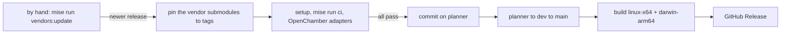

# oc-forge

Patched, jointly pinned releases of OpenCode, OpenChamber, and Orca.

The `vendors/` submodules are pinned to official stable release git tags in
`vendors.json` and are **never modified**. Only `mise run vendors:update`, run by
hand, changes `vendors/` (see *Updating the vendors*): a vendor newly listed in
`vendors.json` becomes a submodule on its next run. Removing a vendor is the owner's
decision, made by hand in one commit: its `vendors.json` entry deleted and its submodule
`git rm`-ed, its `.gitmodules` section with it (VS Code went that way on 2026-11-04).
Fixes live in `adapters/` and are applied in memory while the OpenCode build and the
OpenChamber web build run.

OpenCode V2 uses npm `@opencode/cli`'s `latest` version and its matching git tag;
GitHub's latest release still tracks V1. OpenChamber and Orca use GitHub's latest
non-draft, non-prerelease desktop release. dawn-mac-antropy has no releases, so it
follows the head of its `main` branch; it is private, and the update skips it until it
can read it. Current binary builds cover OpenCode; OpenChamber, Orca, and
dawn-mac-antropy are source-pinned for future joint packaging.

## Adapters

| Vendor | Adapter | Change |
|---|---|---|
| OpenCode | `location-ttl` | Location inactivity eviction default 60 minutes → **24 hours**, so long silent tool calls (e.g. waiting on `codex exec`) are no longer interrupted after an hour. Override at runtime with `OPENCODE_LOCATION_TTL`, e.g. `90 minutes` or `7 days`. |
| OpenChamber | `core` | The `oc-forge` channel for extension frames: **key forwarding** of OpenChamber's navigation shortcuts from frames (and Chrome's tab keys in an app window), **`allow-modals`** for an extension that asks (printing), the `ocForge` manifest block in the catalog, the main layout's host. |
| OpenChamber | `links` | `?extension=<id>&route=<route>` **deep links** to extension pages, and link prefixes for real `<a href>` (Cmd+click opens a browser tab). |
| OpenChamber | `fixes` | A slash command sent first in a folder whose commands OpenCode has not loaded yet still runs as the command (the Planner's assignments to an agent). |

The OpenChamber adapters are a small, versioned extension API with feature
detection: the contract and the client module extensions bundle are in
[`adapters/openchamber/README.md`](adapters/openchamber/README.md). With no
extension using them, OpenChamber looks and behaves as the release.

## Layout

| Folder | Contains |
|---|---|
| `vendors/` | Pristine OpenCode, OpenChamber, and Orca release submodules; `dawn-mac-antropy` is listed to follow its `main` branch and becomes a submodule once `mise run vendors:update` can read it (a private repository it cannot read yet is skipped). |
| `adapters/` | Per-vendor changes: `opencode/`, `openchamber/` (`edits/` to upstream files, the new `host/` UI and `server/` modules they call, `vite-plugin.ts`, and `client/`, the module extensions bundle), and `orca/`. Empty vendor folders are kept with `.gitkeep` until patches are added.; `dawn-mac-antropy/` is kept empty with `.gitkeep` until patches are added. |
| `scripts/` | Everything that builds, syncs and verifies: `adapter-plugin.ts` (adapters as a Bun plugin), `build-preload.ts` (injects it into upstream's build), `build.py`, `build-openchamber.py` (OpenChamber's web package with its adapters), `upstream.py`, `verify.py`. |
| `tests/` | Every test we add: `preload.ts` (loads the same plugin into `bun test`) and `*.test.ts`; `e2e/openchamber-adapters/` runs the OpenChamber adapters against the release in a browser, with a scratch extension. |
| `extensions/` | OpenChamber extensions, installed on the latest OpenChamber release and checked by `mise run test:extensions` in CI, each a submodule of its own public repository: `planner/` (Sunsama-style planning with Linear, GitHub, Google Calendar, Google Tasks, Gmail and agents), [openchamber-planner](https://github.com/antropy-research/openchamber-planner), and `cloak-browser/` (CloakBrowser on the server, shown in OpenChamber's panel for you and the agent), [openchamber-cloak-browser](https://github.com/antropy-research/openchamber-cloak-browser). `file-browser/` (the project's files: a VS Code-style tree and Markdown in Dawn's editor, with Dawn as its submodule) is a submodule of the private [openchamber-file-browser](https://github.com/antropy-research/openchamber-file-browser), marked `update = none` so public CI and fresh clones skip it; with access, `git submodule update --init --checkout --recursive extensions/file-browser`. |
| `containers/` | `openchamber-dev/`: OpenChamber and OpenCode, built from `vendors/` at their pins, and the GitHub CLI, for developing the extensions. |

How it works:

- `scripts/build-preload.ts` is preloaded into upstream's unmodified
  `packages/cli/script/build.ts`. It wraps `Bun.build` and adds one plugin that
  rewrites the matched upstream source in memory.
- Each adapter targets exact upstream code and **fails the build** if that code
  is missing or ambiguous, so an upstream refactor stops the release instead of
  silently dropping the fix. The build also fails if an adapter matched nothing.
- `tests/preload.ts` applies the same plugin in `bun test`, so `tests/` exercise
  real upstream code exactly as it is compiled.
- `scripts/build.py` checks the binary contains the adapted code, that the
  submodule is still pristine, and that the binary starts.

To add an OpenCode adapter: create `adapters/opencode/<name>.ts` exporting an `Adapter`, register
it in `adapters/opencode/index.ts`, and add a test in `tests/` that fails without it.

OpenChamber's web package is built by Vite, so its adapters are a Vite plugin
added to OpenChamber's own config: `scripts/build-openchamber.py` copies the
vendor's tracked files to `build/openchamber/<version>/`, the plugin rewrites the
UI sources there as they load, the server sources (which ship unbuilt) are
adapted when the package is staged, and the result is type-checked with
OpenChamber's own `bun check -b`, checked for the adapted code and packed to
`dist/openchamber-web-<version>.tgz` (`npm install -g` it). The same anchor rule
applies: an edit whose upstream text is missing or ambiguous stops the build.

## Releases

Every push to main is released as the next `v<upstream>-fixed.N`: N counts up
for the same OpenCode version and restarts at 1 when OpenCode releases a new
version (e.g. `v2.0.20-fixed.1`, `v2.0.20-fixed.2`, then `v2.0.21-fixed.1`). Each has
`linux-x64` and `darwin-arm64` (Apple silicon) CLI binaries plus `SHA256SUMS`.
Binaries report the upstream version (e.g. `2.0.20`) so official clients stay
compatible.

- **Disable auto-update** (`OPENCODE_DISABLE_AUTOUPDATE=1`), otherwise the next
  official upgrade replaces the adapted binary.
- macOS binaries are ad-hoc signed, not notarized.
- Releases are artifacts only; nothing is deployed to any server.

## Automation



- `release.yml` publishes every push to main as the next `fixed.N`, only after
  tests pass and all targets build.
- `ci.yml` runs setup and checks on pushes and pull requests.

No workflow moves the vendor pins: that is `mise run vendors:update`, by hand.

## Updating the vendors

On the branch whose pins you update (`planner`), in a checkout with no other
changes, run `mise run vendors:update`. It follows formal release tags, never
moving branches, except for a vendor without releases, which follows its branch
head, and stops at the first step that fails, committing nothing:

1. `sync`: `scripts/vendors.py` moves `vendors.json`, `upstream.json` and the
   submodules to the latest releases (if none is newer: "Up to date", and done);
2. `setup`: with the new pins staged, `mise run setup`;
3. `ci`: `mise run ci`;
4. `openchamber`: `scripts/build-openchamber.py --check-only`, every OpenChamber
   adapter still applies and the result type-checks;
5. `commit`: "chore: update vendor releases", the pins alone.

Each step's output is also in `build/vendors-update/<step>.log`. When a new
release breaks an adapter or a test, the new pins stay staged: fix the adapters
or tests against them, commit those fixes, and run it again; `-- --abort` puts
the branch's pins back. It never pushes; the pins reach main like any change
(`planner`, then `dev`, then `main`), and main's push publishes the release.
`-- --trailer 'Co-authored-by: …'` adds a trailer to its commit.

## Local development

Install [mise](https://mise.jdx.dev/), then:

```sh
mise trust
mise install
mise run setup                        # submodule and locked dependencies
mise run ci                           # same checks as GitHub Actions
mise run test:adapters                # our adapter tests only
mise run build opencode-linux-x64     # dist/opencode-linux-x64.tar.gz
mise run build:openchamber            # dist/openchamber-web-<version>.tgz, with the adapters
mise run check:openchamber            # the OpenChamber adapters apply and type-check
mise run vendors:update               # by hand: newer formal releases, checked, then committed
mise run release:notes
```

`mise run ci` runs upstream lint/type checks, upstream's own lifecycle tests
(unadapted), and our adapter tests (OpenCode's and OpenChamber's). CI also
builds the adapted OpenChamber web package in a job of its own. Tests use upstream's isolated environment
(in-memory database, temporary HOME), not a live OpenCode service. Workflows are
thin shells over these tasks, so failures reproduce locally, except runner
permissions, secrets and the release upload.
